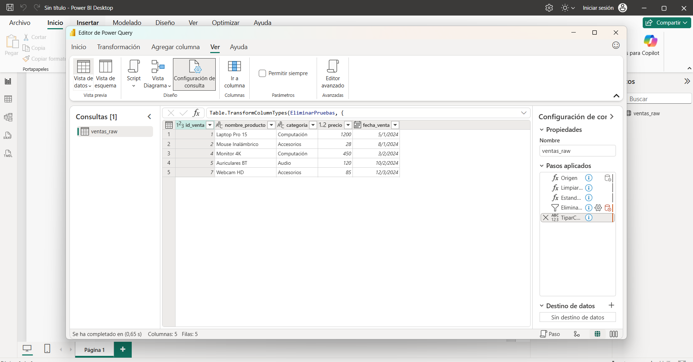

1. ¿Qué hace exactamente el bloque let...in en Power Query? ¿Por qué cada paso puede referenciar al anterior?
El bloque let define un conjunto de pasos o variables secuenciales dentro de Power Query, mientras que la cláusula in determina cuál de esos pasos se devolverá como resultado final. Cada paso hace referencia al anterior porque las funciones de Power Query reciben como primer argumento el identificador del paso previo (ej. Table.TransformColumns(Origen, ...)), construyendo una cadena explícita de dependencias que garantiza la trazabilidad del proceso ETL.

2. ¿Por qué Power Query es Case Sensitive y qué consecuencia práctica tiene? Dá un ejemplo de un error que esto puede causar.
Power Query distingue estrictamente entre letras mayúsculas y minúsculas en identificadores, funciones nativas y valores de texto. Ignorar esto causa errores inmediatos de evaluación. Por ejemplo, escribir table.selectrows en lugar de Table.SelectRows arrojará un error de sintaxis que impedirá compilar la consulta porque la función nativa no será reconocida por el motor.

3. ¿Cuál es la diferencia entre usar Text.Trim y Text.Clean en Power Query?
Text.Trim elimina los espacios en blanco situados exclusivamente al inicio y al final de una cadena de texto.

Text.Clean remueve los caracteres invisibles de control o no imprimibles (como saltos de línea \n o tabulaciones \t) ubicados en cualquier parte del texto.

4. ¿Por qué filtraste los registros "PRUEBA" después de estandarizar la categoría y no antes?
Debido al comportamiento Case Sensitive de Power Query, antes de estandarizar existían variantes como "PRUEBA", "prueba" o "Prueba". Si se aplicara el filtro each ([categoria] <> "Prueba") antes de Text.Proper, los registros en mayúsculas ("PRUEBA") habrían sido ignorados y permanecerían en la tabla. Al aplicar primero Text.Proper, todos los registros de prueba se convierten unívocamente a "Prueba", permitiendo que el filtro los elimine a todos de forma precisa en un solo paso.
 ## Evidencias de Ejecución en Power Query

